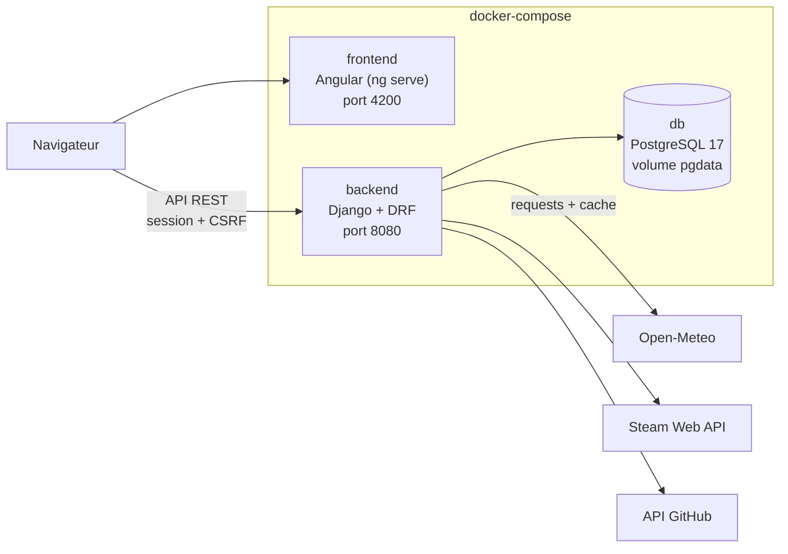
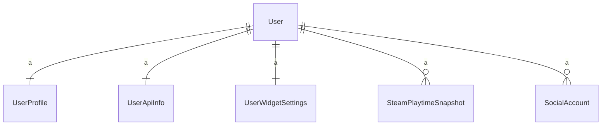
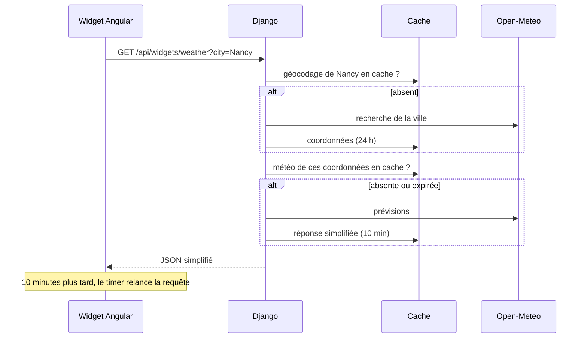
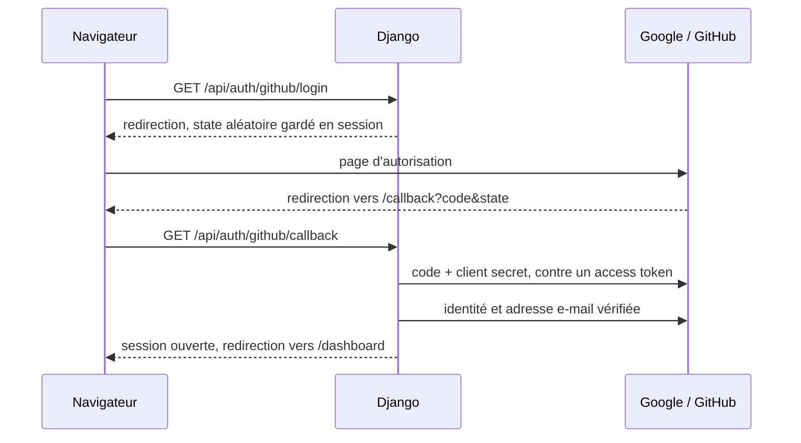

# Architecture

Ce document s'adresse aux développeurs qui reprennent ou évaluent le projet. Il explique comment les parties communiquent, pourquoi ces technologies ont été choisies, et comment fonctionnent les mécanismes les plus importants : l'actualisation des widgets, les appels aux services externes et l'enregistrement des préférences. Pour installer et utiliser l'application, voir le [README](README.md).

## Sommaire

- [Vue d'ensemble](#vue-densemble)
- [Choix technologiques](#choix-technologiques)
- [Modèle de données](#modèle-de-données)
- [Cycle de vie d'un widget](#cycle-de-vie-dun-widget)
- [Le timer d'actualisation](#le-timer-dactualisation)
- [Préférences et traductions](#préférences-et-traductions)
- [Authentification](#authentification)
- [Sécurité](#sécurité)
- [Structure du dépôt](#structure-du-dépôt)

## Vue d'ensemble



Trois conteneurs, trois responsabilités :

- **frontend** sert l'application Angular. Elle ne connaît que l'API Django.
- **backend** gère les comptes, enregistre la configuration de chaque utilisateur et appelle les services externes à sa place.
- **db** stocke les données. Son port n'est pas exposé : seul le backend y accède, par le réseau interne de Docker.

Le navigateur ne contacte jamais Open-Meteo, Steam ou GitHub. C'est Django qui porte les clés d'API et les tokens, appelle les services, met les réponses en cache et renvoie au front une réponse déjà simplifiée. Les secrets ne quittent donc jamais le serveur, et le front n'a pas à connaître le format de chaque API externe.

## Choix technologiques

| Couche | Choix |
| --- | --- |
| Frontend | Angular 22, Angular CDK, Tailwind CSS 4, Bootstrap 5 (grille uniquement) |
| Backend | Django 6.1, Django REST Framework, drf-spectacular |
| Base de données | PostgreSQL 17 |
| Conteneurs | Docker Compose |

### Critères de comparaison

Chaque option a été évaluée sur les mêmes critères, résumés en points positifs et négatifs.

| Critère | Ce qu'on mesure |
| --- | --- |
| Adéquation au besoin | Couverture native des fonctionnalités du projet |
| Compétences du groupe | Ce que l'équipe maîtrise déjà, coût de montée en compétence |
| Écosystème | Bibliothèques disponibles, documentation, communauté |
| Sécurité | Protections fournies par défaut, gestion des secrets et de l'authentification |
| Maintenabilité | Structure imposée, typage, lisibilité pour un projet à plusieurs |
| Intégration Docker | Simplicité de conteneurisation et de déploiement |

### Frontend : framework

| Option | Points positifs | Points négatifs |
| --- | --- | --- |
| **Angular** (retenu) | Routing, formulaires, client HTTP, guards et intercepteurs inclus<br>Signals pour un état réactif sans bibliothèque externe<br>Angular CDK : glisser-déposer et outils d'accessibilité<br>Échappement XSS par défaut, support CSRF dans HttpClient<br>TypeScript natif, structure imposée<br>Déjà pratiqué par le groupe | Courbe d'apprentissage plus raide que React ou Vue<br>Plus verbeux<br>Bundle initial plus lourd |
| **React** | Écosystème le plus vaste<br>Grande communauté<br>Bibliothèque légère et flexible | Routing, formulaires et gestion d'état à choisir à part<br>Conventions à fixer en équipe<br>Notions partielles dans le groupe |
| **Vue** | Prise en main rapide<br>Routing et store officiels | Écosystème plus restreint<br>TypeScript optionnel<br>Peu pratiqué par le groupe |

**Conclusion :** Angular couvre nativement ce que le dashboard demande. Le CDK fournit le glisser-déposer pour déplacer les widgets. L'intercepteur HTTP ajoute en un seul endroit le cookie de session et le jeton CSRF à chaque requête. Les signals rendent l'interface réactive au changement de langue, de thème ou de données sans code supplémentaire. Le groupe connaissait déjà le framework.

### Frontend : style

| Option | Points positifs | Points négatifs |
| --- | --- | --- |
| **Tailwind CSS** (retenu) | Thème sur mesure (couleurs Discord) via variables CSS<br>Pas de CSS mort<br>Compilé au build Angular | Templates chargés de classes<br>Aucun composant prêt |
| **Bootstrap** | Composants prêts à l'emploi<br>Très connu | Look Bootstrap difficile à effacer<br>Conflits avec le preflight de Tailwind |
| **Angular Material** | Composants complets et accessibles | Look Material éloigné de Discord<br>Thème complexe à personnaliser |

**Conclusion :** les couleurs sont des variables CSS définies dans `styles.css`, redéfinies pour le thème clair et pour l'effet verre. Changer de thème revient à changer un attribut `data-theme` sur la page. Bootstrap reste chargé pour sa grille, mais ses classes génériques peuvent entrer en conflit avec les nôtres : les composants évitent par exemple d'utiliser une classe nommée `row`, que Bootstrap met en forme d'office.

Palette du thème sombre :

| Rôle | Couleur |
| --- | --- |
| Fond principal | `#313338` |
| Cartes, panneaux | `#2b2d31` |
| Champs de saisie | `#1e1f22` |
| Accent (boutons, focus) | `#5865f2` |
| Danger | `#da373c` |
| Succès | `#23a55a` |
| Texte | `#f2f3f5` |
| Texte secondaire | `#b5bac1` |
| Liens | `#00a8fc` |

### Backend

| Option | Points positifs | Points négatifs |
| --- | --- | --- |
| **Django + DRF** (retenu) | Authentification, sessions, administration, ORM et migrations inclus<br>Protections CSRF, XSS, injection SQL et hachage des mots de passe par défaut<br>Documentation Swagger générée depuis le code (drf-spectacular)<br>Python pratiqué par le groupe | Pas de typage strict<br>Deux langages dans le projet<br>Structure parfois rigide |
| **NestJS** | TypeScript partagé avec Angular<br>Architecture proche d'Angular | Authentification et ORM à assembler<br>Pas d'administration fournie<br>Nouveau pour le groupe |
| **Spring Boot** | Spring Security très complet<br>Robuste et typé | Configuration lourde, code verbeux<br>Image JVM plus lourde<br>Java peu pratiqué par le groupe |

**Conclusion :** Django répond sans code supplémentaire à plusieurs exigences du sujet : l'inscription et l'authentification, le hachage des mots de passe, et la section d'administration (`/admin`). DRF expose l'API REST consommée par Angular, et drf-spectacular en génère la documentation sur `/api/docs/`. L'authentification utilise les sessions de Django (cookie `sessionid` et jeton CSRF) plutôt qu'un jeton stocké dans le navigateur : le cookie est inaccessible au JavaScript, ce qui limite l'impact d'une éventuelle faille XSS.

### Base de données

| Option | Points positifs | Points négatifs |
| --- | --- | --- |
| **PostgreSQL** (retenu) | Écritures concurrentes sans verrouiller toute la base<br>Contraintes strictes (longueurs, types) appliquées par la base<br>JSONB pour la disposition du dashboard<br>Image Docker officielle, sauvegarde avec `pg_dump` | Un conteneur de plus<br>Attendre que la base soit prête avant de lancer Django |
| **SQLite** (version initiale) | Base par défaut de Django, aucune configuration<br>Aucun conteneur supplémentaire | Une seule écriture à la fois<br>N'applique pas les longueurs maximales des champs<br>Fichier mélangé au code du backend |
| **MongoDB** | Schéma souple pour les configurations | Non supporté par l'ORM Django<br>Relations utilisateur, service et widget peu naturelles |

**Conclusion :** le projet a démarré sous SQLite, puis est passé à PostgreSQL. Plusieurs widgets d'un même utilisateur s'actualisent en parallèle et peuvent écrire en même temps (instantanés du temps de jeu Steam, sauvegarde de la disposition, préférences). PostgreSQL gère ces écritures concurrentes et applique lui-même les contraintes du modèle. Les modèles Django n'ont pas changé : seuls `DATABASES` dans `settings.py` et le service `db` du compose ont été ajoutés. Le conteneur du backend attend que la base soit prête grâce au `healthcheck` du service `db` (`depends_on: condition: service_healthy`).

## Modèle de données



| Modèle | Rôle | Champs principaux |
| --- | --- | --- |
| `User` | Compte (modèle intégré à Django) | `username`, `email`, mot de passe haché, `is_staff` |
| `UserProfile` | Profil et préférences | `sexe`, `age`, `pfp` et `background` (images), `theme`, `glass`, `background_dim`, `text_scale`, `language` |
| `UserApiInfo` | Abonnement aux services | `weather_city`, `steam_id`, clés d'API Steam, `github_token` |
| `UserWidgetSettings` | Disposition du dashboard | `settings` (JSON) |
| `SocialAccount` | Compte Google ou GitHub lié | `provider`, `uid` (identifiant chez le fournisseur), `email`, `login` ; unique par fournisseur et uid, et un seul compte par fournisseur et utilisateur |
| `SteamPlaytimeSnapshot` | Temps de jeu Steam relevé chaque jour | `app_id`, `playtime_forever`, `date` (unique par utilisateur, jeu et jour) |

**Pourquoi la disposition est un seul champ JSON.** Les widgets n'ont pas tous les mêmes paramètres (une ville, un dépôt et un nombre, rien du tout...), et le dashboard est toujours lu et écrit en entier. Un champ JSON évite une table par type de widget et s'enregistre en une seule requête. Chaque widget y est décrit ainsi :

```json
{
  "id": 3,
  "type": "github_commits",
  "title": "",
  "cols": 2,
  "rows": 1,
  "refreshRate": 120,
  "params": { "repo": "pierre54200/Dashboard", "count": 5 }
}
```

Un `title` vide signifie « nom par défaut », traduit dans la langue de l'utilisateur. Un nom saisi à la main est conservé tel quel.

**Pourquoi des instantanés pour le temps de jeu.** Steam ne fournit que le temps de jeu total depuis l'achat, pas celui du mois. Le backend enregistre donc ce total une fois par jour et par jeu, puis calcule la différence avec le dernier relevé du mois précédent.

**Le catalogue des services** (services, widgets et leurs paramètres) est décrit dans `backend/api/about.py`, qui alimente `/about.json`. Côté front, `WIDGET_CATALOG` dans `dashboard.component.ts` décrit les mêmes widgets avec leurs formulaires de configuration.

## Cycle de vie d'un widget

Exemple : un widget météo réglé sur Nancy, actualisé toutes les 10 minutes.



Le traitement côté Django est le même pour tous les widgets :

1. `widget_views.py` lit les paramètres de la requête et l'utilisateur connecté.
2. `integrations.py` récupère ses identifiants dans `UserApiInfo`, appelle l'API externe avec `requests` (délai maximum de 8 secondes) et ne garde que les champs utiles.
3. La réponse est mise en cache, avec une durée propre à chaque widget : 1 minute pour les amis Steam, 10 minutes pour la météo, 15 minutes pour les actualités Steam, etc.
4. Les erreurs (service injoignable, identifiants refusés, limite de requêtes) deviennent un message clair, en code 400 ou 502. Le message ne contient jamais l'URL appelée, qui peut inclure une clé d'API.

Le bouton **Actualiser** d'un widget ajoute `?refresh=1` à la requête : Django ignore alors son cache, sauf si la donnée a moins de 10 secondes. Cliquer en boucle ne peut donc pas épuiser les quotas des API externes.

## Le timer d'actualisation

Chaque widget gère son propre timer, ce qui permet à deux instances du même widget d'avoir des fréquences différentes. La logique est commune à tous les widgets, dans la classe `PollingWidget` (`frontend/src/app/Component/Dashboard/Widgets/polling-widget.ts`) :

- au démarrage, le widget charge ses données, puis programme un `setInterval` à la fréquence choisie (15 secondes minimum) ;
- si un paramètre change (ville, dépôt, fréquence), le timer est annulé, les données rechargées et un nouveau timer programmé ;
- quand le widget est retiré du dashboard, son timer et sa requête en cours sont annulés ;
- pendant un chargement, l'icône Actualiser de la carte tourne, et l'heure de la dernière mise à jour s'affiche en bas de la carte.

Un nouveau widget n'a qu'à hériter de `PollingWidget` et à décrire sa requête dans `fetch()` : le timer, les erreurs et l'état de chargement sont déjà gérés.

## Préférences et traductions

**Rien n'est stocké dans le navigateur.** Langue, thème, taille du texte, effet verre, fond d'écran, photo de profil et disposition du dashboard sont enregistrés sur le compte. On retrouve donc son dashboard à l'identique sur n'importe quel appareil.

- `ProfileService` charge le profil (`GET /api/users/me/profile`) et l'expose sous forme de signal.
- `ThemeService` et `I18nService` réagissent à ce signal et appliquent le thème et la langue à toute la page.
- Une modification est enregistrée immédiatement (`PATCH`). En cas d'échec, le profil est rechargé pour revenir à l'état réel.

**Traductions.** Les textes sont dans deux fichiers, `I18n/fr.ts` (référence) et `I18n/en.ts`. Le type de `en.ts` est dérivé des clés de `fr.ts` : une traduction oubliée empêche la compilation. Les templates utilisent le pipe `t` (`{{ 'dashboard.add_widget' | t }}`), les dates relatives et les heures suivent la langue choisie, et les messages d'erreur renvoyés par Django (en anglais) sont traduits côté front quand ils sont connus. Avant la connexion, la langue suit celle du navigateur. Si l'utilisateur en choisit une autre sur la page de connexion, elle est enregistrée sur son compte à la connexion.

## Authentification

**Inscription et confirmation par e-mail.** Le compte est créé inactif (`is_active=False`) et Django envoie un lien `/confirm-email?uid=...&token=...`. Le jeton est signé avec la clé secrète, expire au bout de 3 jours, et contient l'état `is_active` dans son empreinte : une fois le compte activé, le même lien ne fonctionne plus. Aucune table de jetons n'est nécessaire. Le renvoi du lien répond toujours la même chose, que l'adresse existe ou non, et n'envoie pas plus d'un e-mail par minute.

**Connexion par e-mail.** Le backend d'authentification `EmailOrUsernameBackend` cherche par adresse e-mail (sans tenir compte de la casse) quand l'identifiant contient un `@`, sinon par nom d'utilisateur. Un compte non confirmé reçoit le code `email_not_confirmed` uniquement si le mot de passe est correct, pour ne pas révéler quelles adresses sont inscrites.

**Google et GitHub (OAuth 2.0, flux « authorization code »).**



Le `client_secret` ne quitte jamais le serveur, le `state` protège contre les connexions forgées. Le compte du dashboard est choisi dans cet ordre : compte déjà lié, utilisateur connecté (liaison depuis les paramètres), utilisateur avec la même adresse **vérifiée** par le fournisseur, sinon création d'un compte sans mot de passe. Une adresse non vérifiée n'est jamais utilisée, sinon n'importe qui pourrait prendre le contrôle d'un compte en créant un compte GitHub à son adresse. Le dernier moyen de connexion d'un compte (mot de passe ou compte lié) ne peut pas être dissocié.

Pour GitHub, le scope `notifications` est demandé : le token obtenu est réutilisé par les widgets GitHub si l'utilisateur n'en a pas saisi un lui-même.

## Sécurité

| Risque | Protection |
| --- | --- |
| Vol de mot de passe | Hachage par Django (PBKDF2), jamais stocké ni renvoyé en clair |
| Inscription avec l'adresse d'un autre | Compte inactif tant que le lien envoyé à l'adresse n'a pas été ouvert |
| Énumération des comptes | Mêmes réponses et même temps de réponse que l'adresse existe ou non (connexion et renvoi du lien) |
| Usurpation par OAuth | Paramètre `state` vérifié, liaison automatique uniquement sur une adresse vérifiée par le fournisseur |
| Vol de session par XSS | Cookie de session inaccessible au JavaScript, échappement automatique des templates Angular |
| Falsification de requête (CSRF) | Jeton CSRF exigé pour toute requête qui modifie des données |
| Fuite des clés d'API | Clés et tokens uniquement côté serveur, champs en écriture seule dans l'API (le front ne reçoit que `has_github_token: true`), messages d'erreur sans URL |
| Accès aux données d'un autre utilisateur | Chaque route lit uniquement les données de l'utilisateur connecté |
| Abus des API externes | Cache par widget, délai minimal de 10 secondes pour une actualisation forcée, 15 secondes minimum entre deux actualisations automatiques |
| Fichiers envoyés | Images uniquement (validées par Pillow), 5 Mo maximum, stockées dans `media/` |
| Secrets dans le dépôt | Configuration dans `.env`, ignoré par Git |
| Accès direct à la base | Port PostgreSQL non exposé hors du réseau Docker |

**Limites connues :**

- Les clés Steam et le token GitHub sont stockés en clair dans la base. Les chiffrer (par exemple avec Fernet, de la bibliothèque `cryptography`) protégerait ces secrets en cas de fuite de la base.
- `DEBUG` est lu depuis `DJANGO_DEBUG` et vaut `true` par défaut : le mettre à `false` pour un déploiement.
- Le token GitHub obtenu par OAuth est stocké comme celui saisi à la main, donc en clair lui aussi.

## Structure du dépôt

```
.
├── docker-compose.yml          # services frontend, backend et db
├── .env.example                # variables à copier dans .env
├── README.md                   # présentation, installation, utilisation
├── ARCHITECTURE.md             # ce document
├── backend/
│   ├── Dockerfile
│   ├── requirements.txt
│   ├── manage.py
│   ├── backend/
│   │   ├── settings.py         # base de données, CORS, CSRF, fichiers envoyés
│   │   └── urls.py             # /about.json, /admin, /api, documentation Swagger
│   └── api/
│       ├── models.py
│       ├── serializer.py       # validation des entrées
│       ├── views.py            # comptes, profil, identifiants, disposition
│       ├── widget_views.py     # une route par widget
│       ├── integrations.py     # appels aux API externes, cache
│       ├── about.py            # catalogue des services et widgets
│       └── migrations/
└── frontend/
    ├── Dockerfile
    └── src/app/
        ├── Component/
        │   ├── Auth/           # connexion, inscription
        │   ├── Dashboard/      # grille, fenêtre d'ajout
        │   │   └── Widgets/    # PollingWidget, carte, un dossier par widget
        │   ├── Settings/       # compte, services, connexions, apparence
        │   ├── Legal/          # conditions d'utilisation
        │   └── Shared/         # sélecteur de langue
        ├── Service/            # Widget, Profile, Theme, Auth, User
        ├── I18n/               # fr.ts, en.ts, service et pipe de traduction
        ├── Interceptor/        # cookie de session et jeton CSRF
        ├── Guard/              # accès réservé aux utilisateurs connectés
        └── Interface/          # types des réponses de l'API
```