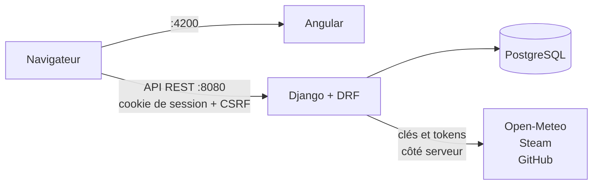

# Dashboard

Dashboard est une application web qui permet à chaque utilisateur de composer son propre tableau de bord à partir de widgets : la météo d'une ville, l'activité de ses amis Steam, ses jeux les plus joués du mois, ses notifications GitHub ou les derniers commits d'un dépôt. Chaque widget se configure, s'actualise tout seul à la fréquence choisie et peut être déplacé, redimensionné, modifié ou supprimé.

L'interface reprend les couleurs de Discord, en thème sombre ou clair, et existe en français et en anglais.

Projet réalisé dans le cadre du module Dashboard d'Epitech.

## Sommaire

- [À quoi ça sert](#à-quoi-ça-sert)
- [Fonctionnalités](#fonctionnalités)
- [Services et widgets](#services-et-widgets)
- [Installation](#installation)
- [Utilisation](#utilisation)
- [Technologies et structure](#technologies-et-structure)
- [API](#api)
- [Développement](#développement)
- [Dépannage](#dépannage)

## À quoi ça sert

Un seul écran pour suivre ce qui vous intéresse, au lieu d'ouvrir dix onglets. Par exemple :

- vérifier la météo de chez soi et de la ville où l'on part le week-end, côte à côte ;
- voir quels amis Steam sont en ligne et à quoi ils jouent ;
- suivre les pull requests qui attendent une revue et les derniers commits du projet de groupe.

## Fonctionnalités

**Compte**

- Inscription avec acceptation des conditions d'utilisation, puis confirmation de l'adresse e-mail par un lien (valable 3 jours, renvoi possible).
- Connexion avec son nom d'utilisateur **ou** son adresse e-mail, et son mot de passe.
- Connexion et inscription en un clic avec **Google** ou **GitHub** (OAuth 2.0). Un compte existant avec la même adresse vérifiée est retrouvé, pas dupliqué.
- Liaison et dissociation des comptes Google et GitHub dans **Paramètres > Connexions**. La connexion GitHub sert aussi de token pour les widgets GitHub.
- Profil modifiable : pseudo, e-mail, sexe, âge, photo de profil.
- Export de ses données au format JSON et suppression du compte (RGPD).
- Section d'administration Django pour gérer les utilisateurs.

**Services**

- La météo est disponible par défaut, sans compte externe.
- Steam et GitHub s'activent en renseignant ses identifiants dans **Paramètres > Services** (Steam ID et clé d'API Steam, token GitHub). Les secrets ne sont jamais renvoyés au navigateur.

**Dashboard**

- Ajouter un widget : choisir son type, le configurer, régler sa fréquence d'actualisation, valider.
- Modifier un widget existant (paramètres, nom affiché, fréquence).
- Déplacer les widgets par glisser-déposer et les redimensionner (jusqu'à 4 colonnes sur 3 rangées).
- Supprimer un widget.
- Plusieurs instances d'un même widget avec des configurations différentes, par exemple la météo de Nancy et celle de Paris.
- Actualisation automatique de chaque widget à son propre rythme, et actualisation immédiate avec le bouton dédié.
- La disposition est enregistrée sur le compte et retrouvée sur n'importe quel appareil.

**Personnalisation** (enregistrée sur le compte, pas dans le navigateur)

- Langue : français ou anglais.
- Thème sombre, clair, ou celui du système.
- Taille du texte, effet verre, image d'arrière-plan.

**Accessibilité**

- Interface responsive, du téléphone au grand écran.
- Navigation au clavier, y compris pour redimensionner un widget (flèches).
- Libellés pour les lecteurs d'écran, respect du réglage « réduire les animations ».

## Services et widgets

| Service | Widget (`about.json`) | Ce qu'il affiche | Paramètres du widget | Prérequis |
| --- | --- | --- | --- | --- |
| Météo | `current_weather` | Température, ressenti, minimum et maximum du jour, humidité, vent | `city` (string) | Aucun |
| Steam | `friends_activity` | Amis en jeu, en ligne ou vus récemment | Aucun pour l'instant | Steam ID et clé d'API |
| Steam | `latest_updates` | Dernières annonces des jeux joués récemment | Aucun pour l'instant | Steam ID et clé d'API |
| Steam | `monthly_playtime` | Jeux les plus joués depuis le début du mois | `count` (integer, 1 à 10) | Steam ID et clé d'API, détails de jeu publics |
| GitHub | `notifications` | Notifications : pull requests, issues, mentions | Aucun pour l'instant | Token GitHub (scope `notifications`) |
| GitHub | `recent_commits` | Derniers commits d'un dépôt | `repo` (string), `count` (integer, 1 à 20) | Aucun pour un dépôt public, token pour un dépôt privé |

Tous les widgets ont aussi une fréquence d'actualisation (de 30 secondes à 30 minutes) et un nom affiché personnalisable.

Sources des données : [Open-Meteo](https://open-meteo.com) pour la météo, la [Steam Web API](https://steamcommunity.com/dev) et l'[API REST de GitHub](https://docs.github.com/rest).

## Installation

### Prérequis

- [Docker](https://docs.docker.com/get-docker/) avec Docker Compose
- Pour Steam : une clé d'API ([steamcommunity.com/dev/apikey](https://steamcommunity.com/dev/apikey)) et son SteamID64 (nombre de 17 chiffres, visible dans l'URL du profil ou sur [steamid.io](https://steamid.io))
- Pour GitHub : un [personal access token](https://github.com/settings/tokens) classique avec le scope `notifications`

Ces identifiants se saisissent dans l'application après l'installation, pas dans les fichiers du projet.

### Configuration

À la racine du dépôt :

```bash
cp .env.example .env
```

Puis remplir `.env` :

| Variable | Rôle |
| --- | --- |
| `DJANGO_SECRET` | Clé secrète de Django : une longue chaîne aléatoire, par exemple générée avec `python3 -c "import secrets; print(secrets.token_urlsafe(50))"` |
| `POSTGRES_DB`, `POSTGRES_USER`, `POSTGRES_PASSWORD` | Nom de la base, utilisateur et mot de passe de PostgreSQL |
| `POSTGRES_HOST`, `POSTGRES_PORT` | `db` et `5432` avec Docker |
| `DJANGO_DEBUG` | `true` par défaut, `false` en production |
| `FRONTEND_URL`, `BACKEND_URL` | Adresses publiques du front et de l'API (`http://localhost:4200` et `http://localhost:8080` par défaut). Servent aux liens des e-mails et aux redirections OAuth |
| `EMAIL_HOST`, `EMAIL_PORT`, `EMAIL_HOST_USER`, `EMAIL_HOST_PASSWORD`, `EMAIL_USE_TLS` | Serveur SMTP pour les e-mails de confirmation. Facultatif : sans `EMAIL_HOST`, les e-mails sont affichés dans les logs du backend |
| `DEFAULT_FROM_EMAIL` | Expéditeur des e-mails, par exemple `Dashboard <noreply@exemple.fr>` |
| `GOOGLE_CLIENT_ID`, `GOOGLE_CLIENT_SECRET` | Facultatif : active « Continuer avec Google » |
| `GITHUB_CLIENT_ID`, `GITHUB_CLIENT_SECRET` | Facultatif : active « Continuer avec GitHub » |

Le fichier `.env` est ignoré par Git : aucun secret ne doit apparaître dans le dépôt.

#### Envoi des e-mails de confirmation

Sans configuration, Django utilise le backend « console » : l'e-mail complet, avec son lien, s'affiche dans les logs.

```bash
docker-compose logs -f backend
```

Pour de vrais envois, avec Gmail par exemple : activer la validation en deux étapes du compte Google, créer un [mot de passe d'application](https://myaccount.google.com/apppasswords), puis :

```env
EMAIL_HOST=smtp.gmail.com
EMAIL_PORT=587
EMAIL_USE_TLS=true
EMAIL_HOST_USER=ton.adresse@gmail.com
EMAIL_HOST_PASSWORD=le-mot-de-passe-d-application
DEFAULT_FROM_EMAIL=Dashboard <ton.adresse@gmail.com>
```

#### Connexion avec Google et GitHub (facultatif)

Les boutons « Continuer avec ... » n'apparaissent que pour les fournisseurs configurés.

**GitHub** : [Settings > Developer settings > OAuth Apps > New OAuth App](https://github.com/settings/applications/new)

- Homepage URL : `http://localhost:4200`
- Authorization callback URL : `http://localhost:8080/api/auth/github/callback`
- Copier le Client ID, générer un Client secret, puis les mettre dans `GITHUB_CLIENT_ID` et `GITHUB_CLIENT_SECRET`.

**Google** : [Google Cloud Console > API et services > Identifiants](https://console.cloud.google.com/apis/credentials)

1. Configurer l'écran de consentement OAuth (type « Externe », ajouter son adresse dans les utilisateurs de test).
2. Créer un ID client OAuth de type « Application Web ».
3. URI de redirection autorisé : `http://localhost:8080/api/auth/google/callback`
4. Mettre l'ID et le code secret dans `GOOGLE_CLIENT_ID` et `GOOGLE_CLIENT_SECRET`.

L'URI de redirection doit correspondre exactement à `BACKEND_URL` suivi de `/api/auth/<fournisseur>/callback`. Après modification du `.env`, redémarrer le backend (`docker-compose up -d backend`).

### Build et lancement

```bash
docker-compose build
docker-compose up
```

Au démarrage, le backend applique les migrations de la base. Trois conteneurs tournent ensuite :

| Conteneur | Rôle | Adresse |
| --- | --- | --- |
| `Dashboard-Front` | Application Angular | http://localhost:4200 |
| `Dashboard-Back` | API Django | http://localhost:8080 |
| `Dashboard-DB` | PostgreSQL | Accessible uniquement depuis le backend |

Adresses utiles :

| Page | Adresse |
| --- | --- |
| Application | http://localhost:4200 |
| `about.json` | http://localhost:8080/about.json |
| Documentation de l'API (Swagger) | http://localhost:8080/api/docs/ |
| Administration | http://localhost:8080/admin/ |

Créer un compte administrateur :

```bash
docker-compose exec backend python manage.py createsuperuser
```

Les données de la base sont conservées dans le volume Docker `pgdata`, entre deux redémarrages comme entre deux builds. `docker-compose down -v` supprime ce volume, et donc toutes les données.

## Utilisation

1. Ouvrir http://localhost:4200, choisir sa langue en haut à droite, puis créer un compte et cliquer sur le lien reçu par e-mail (ou dans les logs du backend si aucun serveur SMTP n'est configuré). On peut aussi utiliser « Continuer avec Google » ou « Continuer avec GitHub ».
2. Sur le dashboard, cliquer sur **Ajouter un widget**, choisir **Météo**, saisir une ville, choisir une fréquence d'actualisation, puis valider.
3. Pour les widgets Steam et GitHub, ouvrir les **Paramètres** (avatar en haut à gauche), section **Services**, et renseigner ses identifiants. Les widgets correspondants affichent ensuite leurs données.
4. Sur chaque carte :
   - l'icône **Actualiser** recharge immédiatement les données ;
   - l'icône **Modifier** rouvre la configuration du widget ;
   - l'icône **Supprimer** le retire du dashboard ;
   - la poignée à gauche du titre permet de le déplacer, le coin inférieur droit de le redimensionner.
5. La section **Apparence** des paramètres règle la langue, le thème, la taille du texte, l'effet verre et l'arrière-plan. La section **Mon compte** gère le profil, la photo, l'export des données et la suppression du compte.

## Technologies et structure

| Couche | Technologies |
| --- | --- |
| Frontend | Angular 22 (signals, composants autonomes), Angular CDK (glisser-déposer), Tailwind CSS 4, Bootstrap 5 (grille) |
| Backend | Python 3.12, Django 6.1, Django REST Framework, drf-spectacular (Swagger), requests |
| Base de données | PostgreSQL 17 |
| Déploiement | Docker Compose |



Le navigateur ne contacte jamais les services externes : Django les appelle à sa place, met les réponses en cache et garde les clés d'API côté serveur.

```
.
├── docker-compose.yml       # front, back et base de données
├── .env.example             # variables à copier dans .env
├── ARCHITECTURE.md          # choix techniques et fonctionnement interne
├── backend/                 # API Django
│   ├── backend/             # réglages et routes principales
│   └── api/
│       ├── models.py        # profil, identifiants des services, disposition du dashboard
│       ├── views.py         # comptes, profil, réglages
│       ├── widget_views.py  # une route par widget
│       ├── integrations.py  # appels aux API externes et cache
│       └── about.py         # /about.json
└── frontend/                # application Angular
    └── src/app/
        ├── Component/       # pages : Auth, Dashboard (et ses widgets), Settings, Legal
        ├── Service/         # appels à l'API, profil, thème
        ├── I18n/            # traductions fr.ts et en.ts
        └── ...
```

Le détail des choix techniques, du modèle de données et du mécanisme d'actualisation est dans [ARCHITECTURE.md](ARCHITECTURE.md).

## API

La documentation complète et interactive est sur http://localhost:8080/api/docs/. Les routes principales :

| Route | Rôle |
| --- | --- |
| `GET /about.json` | Description des services et widgets (format imposé par le sujet) |
| `POST /api/users/register`, `/login`, `/logout` | Inscription (compte inactif jusqu'à confirmation), connexion par pseudo ou e-mail, déconnexion |
| `POST /api/users/confirm`, `/confirm/resend` | Confirmation de l'adresse e-mail avec le lien reçu, renvoi du lien |
| `GET /api/auth/providers` | Fournisseurs OAuth configurés |
| `GET /api/auth/<google\|github>/login`, `/callback` | Connexion avec Google ou GitHub (navigation complète, pas d'appel AJAX) |
| `GET /api/users/me/connections`, `DELETE /api/users/me/connections/<fournisseur>` | Comptes Google et GitHub liés |
| `GET`, `PATCH /api/users/me/profile` | Profil et préférences (JSON, ou multipart pour les images) |
| `GET`, `PATCH /api/users/me/integrations` | Identifiants des services (les secrets sont en écriture seule) |
| `GET`, `POST /api/users/me/widgets` | Disposition du dashboard |
| `GET /api/widgets/<service>/<widget>` | Données d'un widget, par exemple `/api/widgets/weather?city=Nancy` |

L'authentification passe par le cookie de session de Django. Les requêtes qui modifient des données doivent envoyer le jeton CSRF (en-tête `X-CSRFToken`), ce que fait l'intercepteur Angular.

## Développement

**Lint du backend**

```bash
npm run lint
```

**Modifier un modèle Django**

```bash
docker-compose exec backend python manage.py makemigrations
docker-compose exec backend python manage.py migrate
```

Les fichiers de migration générés sont à committer.

**Ajouter un texte à l'interface**

Ajouter la clé dans `frontend/src/app/I18n/fr.ts` et dans `en.ts`, puis l'utiliser dans un template avec `{{ 'ma.cle' | t }}`. Une clé absente de `en.ts` empêche la compilation.

**Ajouter un widget**, en résumé :

1. une fonction dans `integrations.py` et une route dans `widget_views.py` ;
2. sa déclaration dans `about.py` ;
3. un composant dans `Component/Dashboard/Widgets/` qui hérite de `PollingWidget` ;
4. une entrée dans `WIDGET_CATALOG` (`dashboard.component.ts`) et ses textes dans `I18n/`.

## Dépannage

| Symptôme | Cause probable | Solution |
| --- | --- | --- |
| Erreur 500 avec `no such column` ou `relation ... does not exist` | Migrations non appliquées | `docker-compose exec backend python manage.py migrate` |
| Un widget affiche « Service externe injoignable » | Le conteneur backend n'a pas de DNS (fréquent après un changement de réseau) | Redémarrer Docker, ou ajouter `dns: [1.1.1.1, 8.8.8.8]` au service `backend` |
| Un widget Steam affiche « bibliothèque privée » | Détails de jeu privés sur Steam | Profil Steam, Modifier le profil, Confidentialité : « Détails du jeu » en Public |
| Les widgets GitHub restent vides | Token sans le scope `notifications` | Générer un token classique avec ce scope |
| L'e-mail de confirmation n'arrive pas | Pas de serveur SMTP configuré, ou identifiants refusés | Chercher le lien dans `docker-compose logs backend`, vérifier les variables `EMAIL_*` |
| « Lien invalide ou expiré » | Lien déjà utilisé, de plus de 3 jours, ou adresse modifiée entre temps | Demander un nouveau lien sur la page affichée |
| Google affiche `redirect_uri_mismatch` | L'URI de redirection déclarée ne correspond pas | Déclarer exactement `http://localhost:8080/api/auth/google/callback` |
| « La demande de connexion a expiré » après Google ou GitHub | Le cookie de session a été perdu en route | Utiliser `localhost` partout, pas un mélange de `localhost` et `127.0.0.1` |
